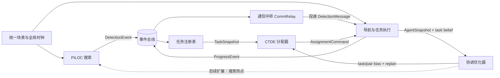

# 系统架构

## 1. 总体结构

系统采用事件驱动的快通路和较慢的协调优化通路：



快通路保证发现后立即进入任务池；慢通路计算优先级、匹配度和重规划建议，不能阻塞救援。
发现消息只有经通信中转写进机器人 belief 之后才可能被分配。协调优化器的输入是
`AgentSnapshot` 里的 belief，不是注册表：注册表只把 `TaskSnapshot` 供给分配器（用于闸门
校验与执行注入），不给协调器供数，避免在线决策绕过通信链读真值。

## 2. 模块边界

### PILOC 搜索模块

输入局部障碍/探索地图和信息素，输出搜索动作、覆盖态势和 `DetectionEvent`。
它不创建 task-03 内部字典，也不决定救援机器人分配。

### 任务注册表

注册表执行目标去重、版本控制和状态机：

```text
HIDDEN → DETECTED → VERIFIED → ASSIGNED → EN_ROUTE
       → IN_PROGRESS → PARTIAL → COMPLETED
```

异常分支包括 `REPLAN_REQUIRED`、`EXPIRED`、`LOST` 和 `FAILED`。

### 通信中转

`CommRelay` 是搜索发现与救援 belief 之间唯一的通道。事件总线把每个
`DetectionEvent` 扇出一次，中转只转发注册表已接受的事件，按已接受的快照生成消息，
再按显式拓扑（`--comm-subscribers`：默认全救援队，也可指定 `first:N` 或救援机器人
id 列表）、每包延迟和丢包率（由 seed 驱动）投递；包丢了就丢了，belief 保持原值。
中转不读任何人的位置，搜索队与救援队仍是两组独立实体，救援集结点是否与搜索起点
重合不影响闭环能否启动。机器人获知任务后的后续更新仍走 TaskEnv 自身的视距感知与
一跳 gossip，因此收紧拓扑只是限制投递范围，并不禁止知识通过其他信道到达。

### 协调与执行的 belief 边界

在线协调器只按每台机器人自己的 belief 打分：`AgentSnapshot.task_beliefs` 携带该机器人
收到的任务位置、剩余需求、截止时间、阶段、进度、复杂度、置信度与登记版本号，
`HeuristicCoordinator` 的输出全部由它推出，绝不读注册表快照——注册表只负责闸门与
生命周期管理，它关闭一个任务并不是任何机器人观察到的事实。任务优先级按机器人分开
发布（`agent_task_bias`）而不是放进 `task_bias`：后者是会被所有机器人共享的池级修正，
任何由单台机器人 belief 推出的数值放进去，都等于把该机器人的知识广播给它从未收到过
消息的机器人。执行侧同理：`apply_action` 用 believed 位置作为导航目标、believed 状态
作为预期状态，任务真值只在到场核实（`verify_task_on_arrival`）时使用；在途重规划也只看
belief，真值显示完成而消息未达时机器人继续前往。分配器只在给命令盖上注册表 revision
时读快照，因为 `AssignmentGate` 需要用它拒绝过期命令，选哪个任务仍来自该机器人自己的
belief。

### 协调优化器

输入搜索覆盖/陈旧度、任务阶段/截止时间、机器人能力/位置/工作状态和执行失败；输出：

- `task_bias[task]`：池级任务优先级修正，所有机器人共享，因此只允许放共同知识；
- `agent_task_bias[agent, task]`：按机器人分开的任务优先级修正，由该机器人的 belief 推出；
- `pair_bias[agent, task]`：机器人—任务匹配修正；
- `replan_agents`：需要重新决策的机器人；
- 后续可选搜索热点。

第一版 `HeuristicCoordinator` 可解释且可作为无学习基线。学习型协调器必须保持相同接口，
并对输出进行有界限制。

### CTDE 分配器

当前以 `task_allocation/old_*` 为主线。Actor 使用本地 belief 和协调消息；Critic 在训练时
使用全局状态。最终动作 logits 加入协调残差后再应用硬 mask。

### 执行模块

接收 `AssignmentCommand`，执行移动、到达、多阶段处理，发布 `ProgressEvent`。
进度定义为：

```text
(已完成阶段数 + 当前阶段完成比例) / 总阶段数
```

同时必须返回当前阶段剩余能力向量。

## 3. 核心数据契约

| 契约 | 生产者 | 消费者 | 关键字段 |
| --- | --- | --- | --- |
| `DetectionEvent` | PILOC adapter | Registry/Coordinator | target ID、位置、时间、置信度、目标属性 |
| `DetectionMessage` | CommRelay | 机器人 belief（经 Task03 adapter） | 发送时快照：位置、阶段、需求、进度、置信度、revision、截止时间 |
| `TaskSnapshot` | Registry | Coordinator/Allocator/Executor | 阶段、剩余需求、截止时间、revision |
| `AgentSnapshot` / `AgentTaskBelief` | Task03 adapter | Coordinator/Allocator | 该机器人收到的任务视图（位置/需求/阶段/进度/置信度/revision） |
| `CoordinationAdvice` | Coordinator | Allocator | 池级 task bias、按机器人的 agent task bias、pair bias、replan、有效期 |
| `AssignmentCommand` | Allocator | Executor | agent/task、task revision、TTL |
| `ProgressEvent` | Executor | Registry/Coordinator | 阶段、剩余需求、进度、失败原因 |

实现定义位于 `integrated_sar/contracts.py`。

## 4. 单步运行顺序

`JointSAROrchestrator.step()` 的顺序固定为：

1. 搜索环境推进并发布新发现。
2. 注册表幂等接收发现并创建/更新任务。
3. 将最新任务快照同步到 task-03 环境。
4. 救援执行环境推进：先投递到期的通信消息（belief 变化被报告为调度信号），
   再推进模拟器并发布进度。
5. 注册表接收进度，协调器按周期或事件（新发现、进度、belief 变化、重规划请求）
   重新计算 advice。
6. 分配器在新任务、进度变化、belief 变化、超时或周期触发时生成命令。
7. 执行器应用命令；机器人从下一物理步开始移动。

## 5. 世界与坐标

PILOC 使用二维栅格 `(row, col)`，task-03 使用归一化连续坐标 `(x, y)`：

```text
x = col / (width - 1)
y = row / (height - 1)
```

正式联合环境还需要统一 `Scenario`，同时产生障碍图、目标隐藏属性、搜索机器人初始状态和
救援机器人能力。任务分配中的距离最终应改为同一障碍图上的最短路径代价。

## 6. 训练阶段

1. **闭环验证**：预训练策略或规则策略 + `HeuristicCoordinator`。
2. **分配适配**：冻结 PILOC，用真实发现事件训练 CTDE 分配器。
3. **协调器训练**：冻结两端策略，训练有界残差协调器。
4. **交替微调**：按 rollout 交替更新搜索、协调、分配策略。

不建议从随机初始化同时联合训练三个网络，因为环境非平稳性和信用分配难度过高。

建议全局目标包含及时完成、阶段进度、有效发现、行进代价、超期、漏检、重复分配、
重规划和通信代价。使用 `source_event_id` 将搜索发现与最终救援结果关联，以提供延迟信用。

## 7. 部署与信息约束

环境维护 `truth state`，Actor/在线协调器维护 `belief state`。严格 CTDE 实验中，
在线模块只能使用经过通信链（上行中转、视距感知、gossip）到达的信息：
观测特征、硬 mask、协调器打分、导航目标与在途重规划全部读 belief 副本，
断联期间真值推进不改变机器人的决策输入与行动目标。机器人是否听说某任务决定它
能否选择该任务；belief 中与决策相关的任一字段变化都会立即成为调度信号。
全局真值只允许模拟器、训练 Critic 和统计指标使用。
