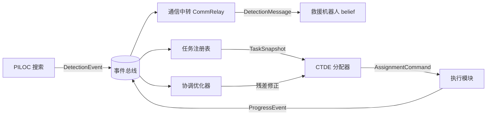

# 一体化搜救框架

这个目录在不修改原始 `piloc` 和 `task-03-修改为CTDE范式` 的前提下，连接搜索、
任务态势、协调优化、任务分配和救援执行。



## 目录职责

- `contracts.py`：模块之间唯一允许交换的数据结构。
- `event_bus.py`：搜索结果和执行反馈一次发布、多方订阅。
- `task_registry.py`：任务去重、版本管理和生命周期管理（seen/accepted/rejected 分类）。
- `comm.py`：搜索发现到救援 belief 的显式通信中转（拓扑、延迟、丢包、seed）。
- `coordinator.py`：无协调基线和可解释的规则协调器。
- `orchestrator.py`：统一时钟，以及实时事件通路和较慢优化通路。
- `adapters/piloc.py`：适配 `piloc/src/Map/timemap.py`。
- `adapters/task03.py`：适配 `old_task_env.py` 和可选的 `old_network.py`。
- `profiles.py`：把 PILOC 点目标转换成多阶段、五维能力任务。
- `demo.py`：不依赖原模型的端到端闭环演示。

## 核心约束

1. PILOC 只发布目标发现事件，不把“发现”当成“完成”。
2. 任务注册表是任务状态的唯一可信来源。
3. 检测消息只有经 `comm.py` 写进机器人 belief 之后才可能被分配；不存在无条件广播，
   中转不读任何人的位置。
4. CTDE 的 observation、硬 mask 和协调器打分只读机器人自己的 belief 副本；
   环境真值只供模拟器、训练 critic 和统计指标使用。
5. 协调器不直接替代分配器，只输出任务优先级和机器人—任务配对偏置。
6. CTDE 环境的硬 mask 始终最后执行，协调器不能放开非法动作。
7. 执行模块返回阶段、剩余能力需求和完成比例，而不只是成功/失败。

当接入 CTDE 网络时，最终任务 logits 为：

```text
final_logits = ctde_logits + residual_scale × coordinator_bias
```

## 运行演示和测试

在 `E:\code` 下使用项目 Python 环境运行：

```powershell
python -m integrated_sar
python -m unittest discover -s integrated_sar/tests -v
```

演示最终应输出：

```text
final_status=completed
```

## 接入 PILOC

创建 `PilocSearchAdapter` 时传入：

- 已构造的 PILOC 环境；
- 当前 `obs` 和 `two_channelmap`；
- 调用已训练 PILOC 策略的 `action_provider`；
- 目标属性生成器或真实传感器分类器。

兼容适配器会围绕现有 `Environment.step` 重建目标发现事件。正式整合时，应在 PILOC
内部发现目标的位置直接发布 `DetectionEvent`，将目标标为 `DETECTED`，等救援完成后再移除。

## 接入 task-03

`Task03Adapter` 同时实现任务注入、机器人状态读取、任务分配和任务执行接口：

```python
task_side = Task03Adapter(env=task_env, network=ctde_network)
joint = JointSAROrchestrator(
    search=search_side,
    task_sink=task_side,
    agent_source=task_side,
    coordinator=HeuristicCoordinator(),
    allocator=task_side,
    executor=task_side,
)
```

传入 `network=None` 时使用规则分配，适合先检查全流程；传入 `old_network` 模型时，
使用 CTDE 输出并叠加协调残差。硬约束仍由 `TaskEnv` 的 mask 控制。

## 训练顺序

1. 用规则协调器验证“发现—注入—分配—执行—完成”闭环。
2. 冻结 PILOC，用真实搜索事件训练任务分配策略。
3. 冻结搜索和分配策略，训练有界残差协调器。
4. 最后采用小学习率交替更新三个模块。

episode 内协调器只推理，网络权重在 rollout 或 episode 结束后更新，避免分配策略在
执行过程中持续漂移。

## 目前仍需处理的原项目问题

- PILOC 当前发现目标后立即从 `goals_pos` 删除；适配器只能兼容重建事件。
- PILOC 的目标只有位置，没有能力需求、阶段和截止时间；当前用确定性占位属性补齐。
- task-03 使用连续空间直线距离，尚未使用 PILOC 障碍地图上的真实最短路径代价。
- 真正加载 `old_task_env.py` 和 `old_network.py` 需要项目环境安装 `torch`。
